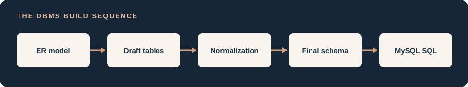
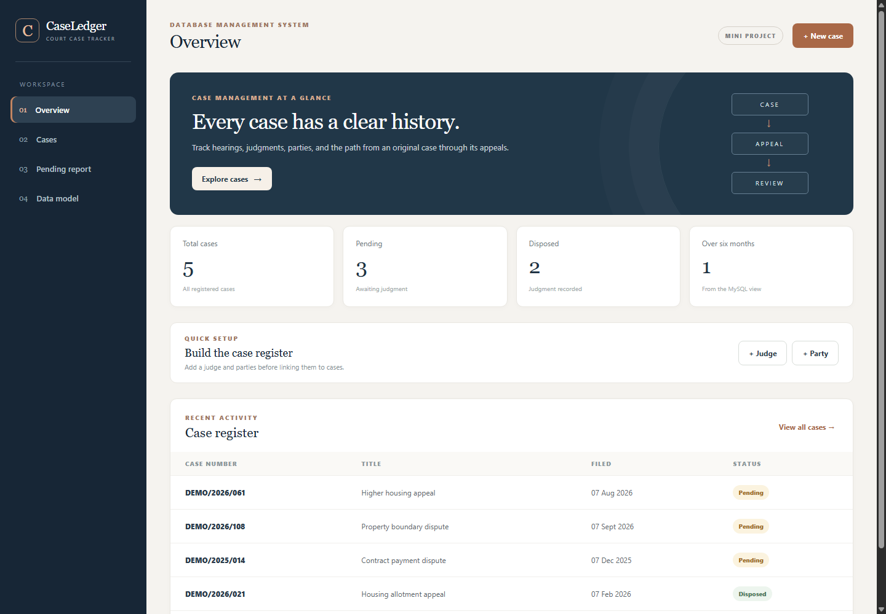

# Court Case and Judgment Tracking System

A small DBMS laboratory application using React, FastAPI, and MySQL. It stores six court domain tables plus two authentication tables and demonstrates a self reference, a many to many relationship, views, triggers, and a recursive query. All sample records are fictional.





The preview uses fictional records. The live application reads all counts and case details from MySQL.

## What you can demonstrate

1. Sign in with the demo account, then register a judge, party, original case, or appeal.
2. Link parties to a case with a role, then record hearings.
3. Record a judgment. The MySQL trigger changes that case to `Disposed`.
4. Open an original case or appeal to see its complete appeal chain.
5. Open the pending report. Its rows come from a MySQL view that checks filing dates against the current date.

## Run locally

For a public HTTPS link with authentication and persistent MySQL, see [deployment instructions](docs/DEPLOYMENT.md). The Docker image serves React and FastAPI from one address. The free hosting configuration is in `render.yaml`.

This computer is already configured. Run `.\scripts\Start-Project.ps1` from the project folder to restart the application. See `QUICK_START.md` for the encrypted local credentials, MySQL command line access, and live verification results.

You need MySQL Server 8.0.16 or later, Python 3.11 or later, and Node.js compatible with your installed Vite version. The project has one local demo account and should use fictional data only. Run `.\scripts\Show-LoginCredentials.ps1` to display its generated password. Sign in with `demo` or `demo@caseledger.local`.

### 1. Create and fill the database

Open MySQL Workbench or another MySQL client. Run these files in order:

1. `sql/schema.sql`
2. `sql/seed.sql`
3. `sql/verify.sql` to inspect the six tables and database features

Run `seed.sql` only once on a fresh database. It inserts five fictional cases, including a three level appeal chain.

After installing the backend dependencies on another Windows computer, run `.\scripts\Setup-Login.ps1` from the project folder. It asks for a MySQL administrator credential when no encrypted credential is present, creates the two authentication tables and demo account, and saves the generated demo password encrypted for the current Windows user. This computer is already configured.

### 2. Start FastAPI

In a PowerShell terminal from the project folder:

```powershell
cd backend
py -3.11 -m venv .venv
.\.venv\Scripts\python.exe -m pip install -r requirements.txt
$env:DB_HOST = '127.0.0.1'
$env:DB_PORT = '3306'
$env:DB_USER = 'root'
$env:DB_PASSWORD = 'your local MySQL password'
$env:DB_NAME = 'court_case_tracker'
.\.venv\Scripts\python.exe -m uvicorn main:app
```

If Python 3.11 is unavailable, use an installed Python 3.12 or 3.13 interpreter. Keep the virtual environment inside this project. The backend receives its database password at runtime. The configured startup script reads a Windows-encrypted credential from `.local`; passwords are not stored in application source files.

Open `http://127.0.0.1:8000/api/health`. It should return `{"status":"ready"}`. FastAPI also provides API documentation at `http://127.0.0.1:8000/docs`.

### 3. Start React

In a second terminal from the project folder:

```powershell
cd frontend
npm install
npm run dev
```

Open the local address printed by Vite, usually `http://localhost:5173`. Vite forwards `/api` requests to FastAPI on port 8000.

## Project files

| Location | Purpose |
| --- | --- |
| `sql/schema.sql` | Six tables, view, trigger, constraints, indexes |
| `sql/seed.sql` | Fictional demonstration records |
| `sql/verify.sql` | Queries for the viva demonstration |
| `backend/main.py` | FastAPI routes and recursive appeal query |
| `backend/db.py` | MySQL connection and query helpers |
| `backend/auth.py` | Password verification, session cookies, API access checks, logout |
| `sql/auth_schema.sql` | Demo account and session tables |
| `frontend/src/Login.jsx` | Login form before the case workspace |
| `frontend/src/App.jsx` | React screens and forms |
| `frontend/src/styles.css` | Responsive presentation styling |
| `docs/DBMS_DESIGN.md` | ER mapping and normalization notes |
| `docs/er_diagram.svg` | Five entity conceptual ER diagram |
| `docs/schema_diagram.svg` | Six table relational schema diagram |

## Design decisions

Used `CASES.parent_case_id` because an appeal has the same core fields as an original case. Used `CASE_PARTIES` because cases and parties have a many to many relationship, and the party's role depends on the particular case. Used direct SQL so the lab's keys, joins, view, trigger, and recursion remain visible.

Used MySQL sessions because sign out can revoke access immediately. Passwords use salted PBKDF2 hashes; session tokens are random, stored as hashes, and sent in HttpOnly cookies. All case APIs require authentication. The demo account can use the shared case workspace; there is no registration, role model, or per-user ownership. See `docs/AUTHENTICATION.md` for the flow, code explanation, tests, and limitations.

The app intentionally has no case deletion, editing, file upload, or public court integration. It is a compact academic demonstration. Case status changes to `Disposed` only when a judgment is inserted. The UI does not allow deleting a judgment, which keeps that status rule simple.
