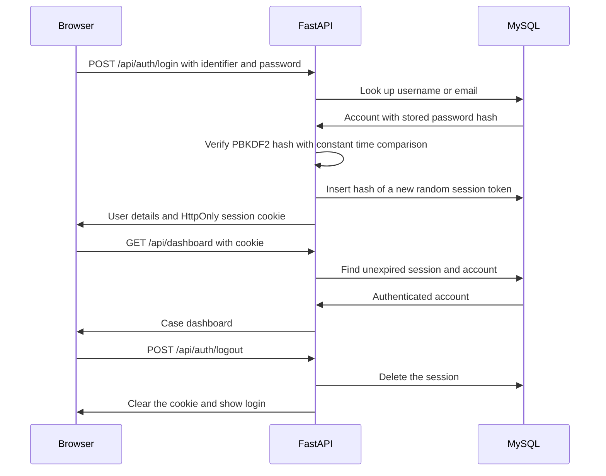

# CaseLedger login

## Requirement and selected approach

The app opens with a username/email and password form before any case data is requested. The user chose one local demo account. There is no registration. Both `demo` and `demo@caseledger.local` identify the same account.

Two approaches were considered. A database session stores a revocable login in MySQL and places a random token in the browser cookie. A signed token carries claims verified by a signing key, but immediate logout requires additional revocation machinery. Used MySQL sessions because the app already uses MySQL and sign out can revoke access immediately.

## Concepts and flow

Authentication means verifying who is signing in. A password hash is a deliberately expensive derived value checked against the supplied password. A salt is a fresh random value that makes identical passwords produce different stored hashes. A session represents an authenticated login across requests. HttpOnly prevents JavaScript from reading the cookie. Authorization in this app grants the one authenticated demo account access to the shared workspace; it does not implement roles or record ownership.

## Files and meaningful code blocks

1. `frontend/src/Login.jsx` owns the identifier, password, visibility toggle, submission state, and error message. Form submission prevents a page reload, calls the parent login handler, and shows a failure without clearing the identifier. Standard autocomplete attributes support password managers. The split layout uses an inline courthouse illustration and adapts to smaller screens.
2. `frontend/src/App.jsx` checks `/auth/me` before rendering the workspace. A 401 shows the login form. Successful login mounts the workspace, which then fetches cases. A later 401 unmounts it and returns to login. Sign out calls the backend before clearing the user. An unsuccessful logout leaves the workspace visible with an error.
3. `frontend/src/api.js` sends same-origin cookies and the `X-CaseLedger-Request` header. It marks API requests as noncached and converts API errors into messages. Unauthorized case API responses emit an event handled by the root component.
4. `backend/auth.py` hashes passwords with PBKDF2-HMAC-SHA256, 600,000 iterations, and a fresh 16-byte salt. Verification recomputes that hash and compares it with `hmac.compare_digest`. Unknown identifiers still execute a dummy password check and receive the same error as a wrong password.
5. Login generates a 32-byte random token and stores its SHA256 hash in `auth_sessions`. SHA256 is appropriate for these already random tokens; passwords need the slower PBKDF2 derivation. The raw token appears only in the browser cookie. It is never returned as a JSON field or stored in the database.
6. `current_user` validates the cookie, looks up the token hash, checks expiry in MySQL, and returns only public account fields. The protected router in `backend/main.py` applies this dependency to every case, judge, party, dashboard, and report route. The health route remains public so startup checks work.
7. Login rotates the current browser session. Logout deletes its server record and clears the cookie, so replaying that token no longer works. Expired session rows are removed during successful login. Active sessions have an absolute eight-hour lifetime.
8. Mutation routes require a custom request header. They also reject an Origin outside the configured local origins. The app does not enable cross-origin access. These checks and SameSite Strict reduce cross-site request forgery risks.
9. `sql/auth_schema.sql` adds two tables without changing the six court domain tables. `auth_users` stores one unique username, unique email, display name, and password hash. `auth_sessions` references the account through a foreign key and indexes session expiry.
10. `scripts/Setup-Login.ps1` generates a demo password and saves it encrypted for the Windows user. `scripts/setup_auth.py` creates the tables, inserts the hashed account, and grants the runtime database account session cleanup permissions. Rerunning setup verifies the existing credential and does not reset the account.

## Verification and limits

Login verification passed 41 checks against the actual API and database, with isolated checks of the rate limiter and password hashing helpers. These cover unauthenticated reads and writes, incorrect and absent accounts, exact password matching, username and email login, cookie properties, token hashing, session rotation, logout revocation, expiry, and untrusted request rejection. The existing 28 live database/API checks also passed after being updated to sign in first. The frontend production build passed.

The browser tool rejected visual verification because a saved permission setting blocks the local URL, even after the user approved browser verification in chat. The final login layout and browser click flow were not visually verified.

The cookie is a browser session cookie, so reloads preserve login while it remains valid. Browser session restoration can preserve such cookies across a browser restart; do not describe closing a tab or browser as guaranteed logout. Sign out is the explicit revocation action. For this HTTP localhost demonstration the Secure cookie flag is off. HTTPS deployments must enable `AUTH_COOKIE_SECURE=true` and configure exact trusted origins. The rate limiter keeps at most 1,000 client buckets and allows ten login attempts per minute per client address in one backend process. A shared deployment would need a coordinated limiter, HTTPS, operational monitoring, and an account recovery policy.

## Interview explanation

"I added a login gate to React and enforced it on every data endpoint in FastAPI. The account password is stored as a salted PBKDF2 hash. Successful login generates a random cookie token whose hash is stored in MySQL with an expiry. Each protected request checks that session. Logout deletes it, so access is revoked immediately. I verified unauthorized access, invalid credentials, token rotation, expiration, and logout against the actual database."

Retention question: Why can sessions use a fast SHA256 hash while passwords need a slower password derivation function? Answer: session tokens are already unpredictable random values; human passwords have much less entropy and need expensive guessing resistance.

Sources: [OWASP password storage](https://cheatsheetseries.owasp.org/cheatsheets/Password_Storage_Cheat_Sheet.html), [OWASP session management](https://cheatsheetseries.owasp.org/cheatsheets/Session_Management_Cheat_Sheet.html), [OWASP CSRF prevention](https://cheatsheetseries.owasp.org/cheatsheets/Cross-Site_Request_Forgery_Prevention_Cheat_Sheet.html), [FastAPI response cookies](https://fastapi.tiangolo.com/advanced/response-cookies/).
