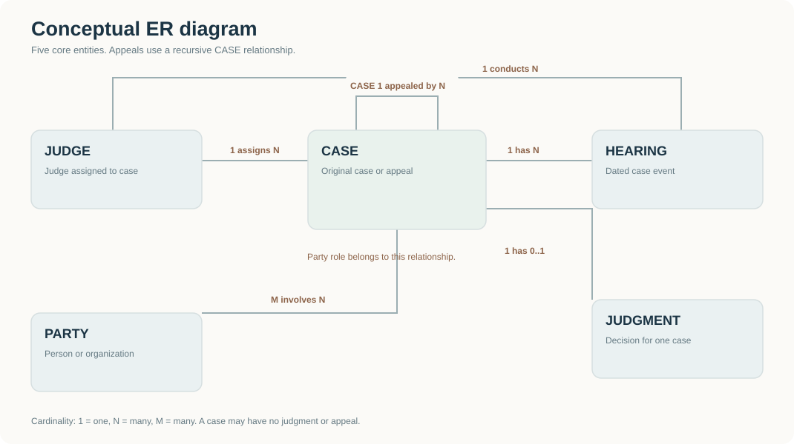
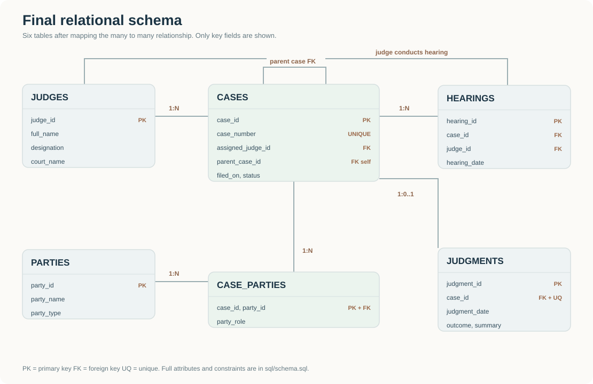

# DBMS design path


This document follows the sequence in the supplied classroom handout. The handout is a method reference; its library example is not part of this project.

## 1. Requirements and ER model

The conceptual ER model has five core entities: `CASES`, `JUDGES`, `HEARINGS`, `JUDGMENTS`, and `PARTIES`. `CASE_PARTIES` is the associative table produced when the case to party many to many relationship is mapped into the relational schema. This gives six court domain tables. Login adds `auth_users` and `auth_sessions`, bringing the running database to eight tables; the diagrams below describe the six court domain tables.



Business rules:

1. One judge may be assigned to several cases. Each case has one assigned judge in this mini project.
2. One case may have several hearings. A hearing records the judge who conducted it.
3. One case has at most one judgment. Inserting it disposes that case.
4. One case may have several appeal cases. Each appeal has at most one parent case.
5. One case may involve several parties, and one party may appear in several cases. `CASE_PARTIES.party_role` describes the role in one specific case.

## 2. ER conversion to draft tables

Only the rules relevant to this ER model apply:

| ER pattern | Conversion | Result |
| --- | --- | --- |
| Strong entities | Make each entity a table with a primary key | `CASES`, `JUDGES`, `HEARINGS`, `JUDGMENTS`, `PARTIES` |
| One judge to many cases | Put the judge key on the case side | `CASES.assigned_judge_id` |
| One case to many hearings | Put the case key on the hearing side | `HEARINGS.case_id` |
| One case to zero or one judgment | Put a unique case key in judgments | `JUDGMENTS.case_id` |
| Case to appeal case | Put the parent case key in the child case | `CASES.parent_case_id` |
| Many cases to many parties | Make an associative table | `CASE_PARTIES(case_id, party_id, party_role)` |

The draft table list is therefore the same six tables shown above. The normalization audit below checks whether that draft needs further splitting.

## 3. Normalization audit

**First normal form:** Each field stores one value. Party names are not kept as a comma separated list inside `CASES`, and hearing dates are not repeated as `hearing_1`, `hearing_2`, and so on. Each party link and each hearing has its own row.

**Second normal form:** Most tables have a single column primary key. `CASE_PARTIES` has the composite key `(case_id, party_id)`. `party_role` depends on both parts: the same party can be a Petitioner in one case and a Respondent in another. It does not depend on `case_id` alone or `party_id` alone.

**Third normal form:** A party's name and type live in `PARTIES`, not in `CASE_PARTIES`; a judge's name lives in `JUDGES`, not in `CASES` or `HEARINGS`. Nonkey facts are stored with the entity they describe. Under this project's business rules, the six tables satisfy 3NF.

The audit confirms the mapped draft; it does not force a seventh table. Adding a table only to inflate the count would make the design harder to defend.

## 4. Final relational schema

`PK` means primary key. `FK` means foreign key. `UQ` means unique.

```text
JUDGES(judge_id PK, full_name, designation, court_name)
PARTIES(party_id PK, party_name, party_type)
CASES(case_id PK, case_number UQ, title, court_name, filed_on,
      case_status, assigned_judge_id FK, parent_case_id FK)
CASE_PARTIES(case_id PK/FK, party_id PK/FK, party_role)
HEARINGS(hearing_id PK, case_id FK, judge_id FK,
         hearing_date, purpose, hearing_status)
JUDGMENTS(judgment_id PK, case_id FK/UQ,
          judgment_date, outcome, summary, document_url)
```



The exact MySQL data types and constraints are in `../sql/schema.sql`.

## 5. Physical SQL and demonstration

Run `../sql/schema.sql`, then `../sql/seed.sql`, then `../sql/verify.sql`. In the viva, show these observable results:

1. The catalog contains six base tables.
2. A join through `CASE_PARTIES` shows each party's role for a case.
3. `DEMO/2025/001` and `DEMO/2026/021` are `Disposed` because inserting judgments activated the trigger.
4. The pending view returns only old cases that are still `Pending`.
5. The recursive query returns original case 101, appeal 201, and higher appeal 301 in order.

## Interview explanation

"I started with the entities and relationships, mapped one to many relationships using foreign keys, and resolved the case to party many to many relationship with `CASE_PARTIES`. I audited the draft for 1NF, 2NF, and 3NF before writing the final schema. The database then enforces keys and uses triggers, a view, and a recursive query for the main behaviors."

## Verified MySQL behavior

The local setup was verified on MySQL 8.0.46 on 8 October 2026. MySQL does not permit a CHECK constraint to reference an AUTO_INCREMENT column, so the own-parent rule is enforced by an AFTER INSERT trigger and a BEFORE UPDATE trigger instead. The AFTER INSERT trigger sees the actual generated case ID. Both triggers reject a row whose parent_case_id equals its case_id. These checks prevent a direct self-parent link; they do not detect longer cycles created by manual database updates.

The separate judgment trigger changes the related case to Disposed. The six tables, sample inserts, pending view, joins, and recursive appeal query were executed on the real database. Twenty-eight live checks passed, including invalid input rejection, rollback of trigger test writes, and API reads through the frontend proxy. Exact results are in `MYSQL_VERIFICATION.txt` and `LIVE_VERIFICATION.txt`.
