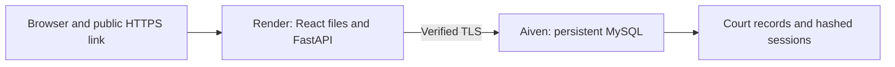

# Public deployment

The free hosting setup uses one Render Docker web service and an external Aiven MySQL database. The React application and `/api` share the same HTTPS origin, so browsers send the authentication cookie correctly.

## Create the database

1. Create an Aiven account and select the free MySQL plan. Do not select a paid trial.
2. Wait for the database to become ready. Record its host, port, database name, user and password directly in Render's environment settings.
3. Use the database name Aiven supplies, typically `defaultdb`. The initializer selects the configured database and does not require permission to create another database.
4. Download the project's CA certificate from Aiven. Paste its complete PEM contents into Render's `DB_SSL_CA_PEM` environment variable, preserving line breaks. The server materializes this certificate at runtime and verifies both the certificate and hostname. Do not disable verification to work around a certificate error. A certificate already mounted as a file can instead be selected using `DB_SSL_CA`.

## Create the web service

1. In Render, create a Docker web service from this GitHub repository and select the Free instance.
2. Set `APP_ENV=production`, `AUTH_COOKIE_SECURE=true` and `DB_SSL=true`.
3. Set `DB_HOST`, `DB_PORT`, `DB_NAME`, `DB_USER` and `DB_PASSWORD` from Aiven.
4. Choose a demo password of at least 12 characters and set `AUTH_DEMO_PASSWORD`. Keep it outside GitHub.
5. Set `APP_ALLOWED_HOSTS` to the Render hostname, without a scheme or path. Set `AUTH_TRUSTED_ORIGINS` to its full HTTPS origin, without a trailing slash.
6. Use `/api/health` as the health check. Render supplies `PORT`; the container binds to it automatically.
7. Deploy. The initializer creates schema, fictional seed records and the demo login only when appropriate. It never drops an existing table or resets a password. A partial schema fails with an explicit error instead of silently reseeding it.

`render.yaml` contains the equivalent Blueprint configuration. Values marked `sync: false` must be supplied during setup.

## Check the deployed link

1. Open `/api/health` and confirm `{"status":"ready"}`.
2. Open the root link in a fresh browser. Confirm that sign in appears and `/api/cases` returns 401 before login.
3. Sign in with username `demo` and the password configured in Render.
4. Refresh the page. Confirm the workspace remains available in the same browser session.
5. Open a case and its appeal chain. Check the pending report.
6. Sign out. Confirm that refreshing still shows sign in and the former session cannot read `/api/cases`.
7. Restart the Render service and confirm that records remain in MySQL.

Render's free service sleeps after 15 idle minutes. The next visit can take about a minute to wake it. A sleeping service is not an authentication failure. Hosting limits and free plans can change; verify them in the provider dashboards.

This is a shared academic workspace with fictional records. Authentication grants access to the whole workspace. It does not provide separate records for each user.

## Local production preview

Run `npm ci` and `npm run build` in `frontend`, then start FastAPI. If `frontend/dist` exists, FastAPI serves the complete application on port 8000. The original two process development workflow also remains available.

Never upload `.local`, environment files, database dumps, logs, or credential XML files. Do not expose the local MySQL server to the internet.
